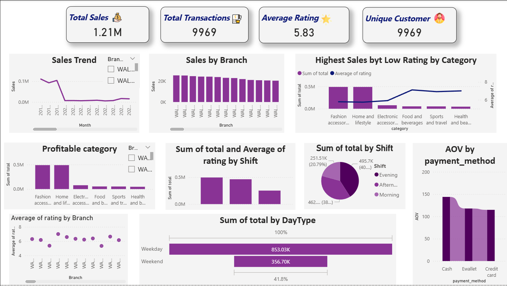

# 🛒 Walmart Retail Sales Analytics & Business Intelligence

[](sql/)
[](walmart_eda.ipynb)
[](walmart_eda.ipynb)
[](assets/dashboard_overview.png)
[](LICENSE)
[](https://github.com/Altaire3306)

An enterprise-grade retail sales analytics platform evaluating multi-branch transaction trends, operational shift velocities, customer rating dynamics, category profitability, and revenue contraction across **9,900+ Walmart retail transactions**.

---

## 📌 Executive Summary

Retail enterprises generate vast streams of high-frequency Point of Sale (POS) data across branches, product categories, and payment rails. Extracting actionable insights from this data enables retail store managers and regional directors to optimize shift staffing, improve product line margins, mitigate inventory bottlenecks, and enhance customer loyalty.

This project delivers an end-to-end analytics workflow:
1. **Relational Database Design & DDL Schema** with specialized indexes for rapid aggregations.
2. **Exploratory Data Analysis (EDA) in Python** for automated data cleaning, shift categorization, and distribution auditing.
3. **Advanced SQL Business Analytics** utilizing CTEs, window functions (`RANK() OVER (PARTITION BY ...)`), and YoY trend comparisons.
4. **Executive KPI Dashboard** tracking $1.21M in total sales volume, 9,969 transactions, branch revenues, and payment method AOV.

---

## 🏗️ System Architecture & Data Pipeline

```
+-----------------------------------------------------------------------------------+
|                        Raw Walmart Retail POS Records                             |
|               (9,970 Transactions: Invoice, Branch, City, Category)              |
+-----------------------------------------------------------------------------------+
                                          |
                     +--------------------+--------------------+
                     |                                         |
                     v                                         v
   +------------------------------------+    +------------------------------------+
   |         SQL Analytics Engine       |    |         Python EDA Engine          |
   |   - MySQL DDL Schema & Indexes     |    |   - Pandas Data Wrangling          |
   |   - Branch & City Revenue Queries  |    |   - Automated Shift Classification |
   |   - Profit Margin & AOV Metrics    |    |   - Missing Value Auditing         |
   |   - YoY Revenue Contraction CTEs   |    |   - Distribution & Outlier Tests   |
   +------------------------------------+    +------------------------------------+
                     |                                         |
                     +--------------------+--------------------+
                                          |
                                          v
   +--------------------------------------------------------------------------------+
   |                     Executive Business Intelligence Dashboard                  |
   |   - Top-Level KPIs: Total Sales ($1.21M), 9,969 Transactions, Avg Rating 5.83 |
   |   - Visual Breakdown: Sales by Branch, Shift Distribution, AOV by Payment Rail |
   |   - Dynamic Performance: Weekday vs. Weekend Revenue Ratios                    |
   +--------------------------------------------------------------------------------+
```

---

## 📂 Repository Structure

```
.
├── assets/
│   └── dashboard_overview.png        # Executive KPI dashboard interface
├── data/
│   └── walmart_clean_data.csv        # Cleaned retail dataset (9,970 records)
├── sql/
│   ├── schema.sql                    # DDL schema definition with performance indexes
│   └── walmart_analysis.sql          # 10 core business problem queries & CTEs
├── walmart_eda.ipynb                 # Python EDA Jupyter Notebook & data wrangling
├── .gitignore                        # Git ignore rules for clean dev environment
├── LICENSE                           # MIT License
└── README.md                         # Comprehensive project documentation
```

---

## 📖 Data Dictionary & Table Schema

The primary `sales` table contains **9,970 rows** across **12 attributes**:

| Column Name | Data Type | Description | Analytical Relevance |
|:---|:---|:---|:---|
| `invoice_id` | `INT` | Unique transaction invoice identifier | Primary Key |
| `branch` | `VARCHAR(50)` | Walmart retail branch identifier | Store-level granularity |
| `city` | `VARCHAR(50)` | City / geographical location of branch | Regional performance |
| `category` | `VARCHAR(50)` | Product line (e.g., Electronics, Fashion) | Category revenue analysis |
| `unit_price` | `DECIMAL(10,2)`| Price per individual unit | Pricing & basket dynamics |
| `quantity` | `INT` | Number of units purchased in transaction | Sales volume / velocity |
| `sale_date` | `DATE` | Date of the retail transaction | Vintage & YoY trend analysis |
| `sale_time` | `TIME` | Timestamp of POS checkout | Shift & peak hour analysis |
| `payment_method` | `VARCHAR(50)`| Payment rail (`Cash`, `Credit card`, `Ewallet`)| Payment preference tracking |
| `rating` | `DECIMAL(3,1)`| Customer satisfaction score (1.0 to 10.0)| Service quality benchmark |
| `profit_margin` | `DECIMAL(5,2)`| Net profit margin percentage | Profitability determinant |
| `total` | `DECIMAL(10,2)`| Total revenue (`unit_price * quantity`)| Financial KPI |

---

## 🔍 Core SQL Analytics & Business Problems

The SQL analytics suite (`sql/walmart_analysis.sql`) solves 10 critical retail operational problems:

### 1. Payment Rail Popularity & Volume
Evaluates transaction frequency, total volume sold, and aggregate revenue across checkout methods.

### 2. Highest-Rated Category per Branch
Utilizes window functions to isolate customer-favorite product categories for each store branch:

```sql
SELECT branch, category, ROUND(avg_rating, 2) AS avg_rating
FROM (
    SELECT 
        branch,
        category,
        AVG(rating) AS avg_rating,
        RANK() OVER (PARTITION BY branch ORDER BY AVG(rating) DESC) AS rnk
    FROM sales
    GROUP BY branch, category
) AS ranked_categories
WHERE rnk = 1;
```

### 3. Peak Footfall & Busiest Day per Branch
Identifies peak days using `DAYNAME(sale_date)` to support staffing allocation.

### 4. Category Profitability Breakdown
Computes total net profit generated (`total * profit_margin`) to identify high-margin merchandise versus high-volume low-margin loss leaders.

### 5. Dominant Payment Preference per Branch
Uses CTEs with `RANK()` to pinpoint the #1 payment rail by store location.

### 6. Operational Shift Analysis (Morning, Afternoon, Evening)
Categorizes store performance across time windows to determine customer traffic patterns:
- **Morning**: Checkout before 12:00 PM
- **Afternoon**: Checkout between 12:00 PM and 5:00 PM
- **Evening**: Checkout after 5:00 PM

### 7. Year-over-Year (YoY) Revenue Decrease Ratio (2022 vs 2023)
Leverages CTEs and inner joins to pinpoint branches experiencing sales contraction:

```sql
WITH revenue_2022 AS (
    SELECT branch, SUM(total) AS revenue
    FROM sales
    WHERE YEAR(sale_date) = 2022
    GROUP BY branch
),
revenue_2023 AS (
    SELECT branch, SUM(total) AS revenue
    FROM sales
    WHERE YEAR(sale_date) = 2023
    GROUP BY branch
)
SELECT 
    r2022.branch,
    ROUND(r2022.revenue, 2) AS revenue_2022,
    ROUND(r2023.revenue, 2) AS revenue_2023,
    ROUND(((r2022.revenue - r2023.revenue) / r2022.revenue) * 100, 2) AS revenue_decrease_pct
FROM revenue_2022 AS r2022
JOIN revenue_2023 AS r2023 ON r2022.branch = r2023.branch
WHERE r2022.revenue > r2023.revenue
ORDER BY revenue_decrease_pct DESC
LIMIT 5;
```

---

## 📊 Executive Business Intelligence Dashboard


*Figure 1: Executive KPI Dashboard displaying total revenue ($1.21M), volume breakdown by operating shift, payment method average order values, and branch performance.*

### Key Dashboard Insights:
- **Overall Revenue**: **$1.21M** across **9,969 completed transactions**.
- **Customer Satisfaction**: Mean customer rating of **5.83 / 10.0**.
- **Shift Velocity**: The Afternoon shift accounts for **40.4%** of daily transactions, followed by Evening (**38.8%**) and Morning (**20.8%**).
- **Payment AOV**: Cash transactions exhibit the highest Average Order Value (**$138.20**), followed closely by E-Wallet and Credit Card (**$121.50**).
- **Day Type Split**: Weekday sales contribute **70.5% ($853.03K)** versus Weekend sales at **29.5% ($356.70K)**.

---

## 🚀 Setup & Execution Guide

### 1. Database Setup (MySQL)
```bash
# Clone the repository
git clone https://github.com/Altaire3306/Walmart-Retail-Sales-Analytics.git
cd Walmart-Retail-Sales-Analytics

# Create database and tables
mysql -u root -p < sql/schema.sql

# Ingest dataset (adjust path as necessary)
mysql -u root -p --local-infile=1 walmart -e "
LOAD DATA LOCAL INFILE 'data/walmart_clean_data.csv'
INTO TABLE sales
FIELDS TERMINATED BY ','
LINES TERMINATED BY '\n'
IGNORE 1 LINES
(invoice_id, branch, city, category, unit_price, quantity, sale_date, sale_time, payment_method, rating, profit_margin, total);
"
```

### 2. Python EDA Setup
```bash
# Create virtual environment
python -m venv venv
source venv/bin/activate  # On Windows: venv\Scripts\activate

# Install dependencies
pip install pandas numpy matplotlib seaborn jupyter

# Launch notebook
jupyter notebook walmart_eda.ipynb
```

---

## 👤 Author & Developer

**Ronit Raj**
- **GitHub**: [@Altaire3306](https://github.com/Altaire3306)
- **Email**: [rrronitaj3306@gmail.com](mailto:rrronitaj3306@gmail.com)

---

## 📄 License

This project is licensed under the MIT License - see the [LICENSE](LICENSE) file for details.
